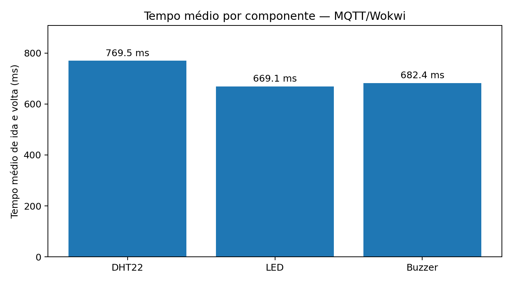

# Botão de emergência conectado — IoT (protótipo virtual)

Projeto acadêmico da disciplina **Objetos Inteligentes Conectados**, Universidade Presbiteriana Mackenzie. Demonstra um botão de emergência simulado com **ESP32**, sensor ambiental **DHT22**, LED e buzzer, utilizando comunicação **MQTT via Wi-Fi**. O circuito e seu firmware são executados no **Wokwi**; o MQTT pode ser acompanhado e comandado pelo **MQTTX Web**.

> **Escopo:** protótipo acadêmico virtual. Não é dispositivo médico nem sistema de emergência real. Não foi executada montagem física. O Telegram, previsto em uma versão inicial do artigo, **não está implementado** neste firmware e não deve ser apresentado como funcionalidade concluída.

## O que funciona na simulação

- Leitura da temperatura e umidade do DHT22 e publicação MQTT a cada 5 segundos.
- Acionamento local do botão `AJUDA`: LED e buzzer por aproximadamente 4 segundos; publicação do evento `AJUDA_SOLICITADA`.
- Recepção do comando `ALERTA` via MQTT: aciona LED e buzzer; `PARAR` interrompe o alarme.
- Mensagens de estado e rotina de medições sob os tópicos `medicao/pedido` e `medicao/resposta`.

**Validação informada nos testes realizados:** leituras ambientais recebidas no MQTTX, mensagem de emergência por acionamento do botão e acionamento remoto via comando `ALERTA`. Os arquivos deste repositório documentam esses testes; eles não constituem validação clínica nem teste em hardware físico.

## Componentes e ligações

| Componente | ESP32 | Observação |
|---|---|---|
| DHT22 — DATA/SDA | GPIO 15 | VCC 3,3 V, GND e resistor pull-up de 10 kΩ |
| Botão `AJUDA` | GPIO 18 | Botão até GND; usa `INPUT_PULLUP` |
| LED vermelho | GPIO 23 | Resistor em série de 220 Ω até ânodo do LED; cátodo ao GND |
| Buzzer | GPIO 25 | Outro terminal ao GND, conforme `diagram.json` |

Placa: `board-esp32-devkit-c-v4`. A rede Wi-Fi é virtual (`Wokwi-GUEST`). **Não foi usado shield nem gateway Node-RED**, pois o ESP32 possui Wi-Fi integrado e se comunica diretamente com o broker.

## Como reproduzir no Wokwi

1. Abra https://wokwi.com/projects/new/esp32 .
2. Substitua os arquivos `sketch.ino`, `diagram.json` e `libraries.txt` pelos arquivos de mesmo nome deste repositório.
3. Verifique no Library Manager as bibliotecas `PubSubClient` e `DHT sensor library for ESPx` (`DHTesp`).
4. Clique em **Start Simulation**. Aguarde o Serial Monitor indicar `[Wi-Fi] CONECTADO!` e `[MQTT] CONECTADO!`.
5. Pressione o botão virtual vermelho (`AJUDA`) e veja o LED, o buzzer e o evento MQTT.

**Observação:** caso a rede virtual esteja lenta, a conexão pode levar alguns segundos. Evite reiniciar ou reescrever o sketch durante uma tentativa de conexão bem-sucedida.

## MQTT — como acompanhar e controlar

- Broker público: `broker.emqx.io`, porta **1883** (TCP MQTT para o ESP32).
- Cliente web: https://mqttx.app/web-client, protocolo **WSS**, servidor `broker.emqx.io`, porta **8084**, caminho `/mqtt`.
- Assine o tópico `mackenzie/oic/botao_b71f92/#` para receber todos os dados do projeto.
- Envie `ALERTA` (texto simples, não JSON) ao tópico `mackenzie/oic/botao_b71f92/comando` para ativar o alarme; envie `PARAR` para desligar. Usar QoS 0 e **Retain desligado**.

É um **broker público sem autenticação**: use apenas dados fictícios de demonstração. Não publique informações pessoais ou de pacientes. Como o prefixo é fixo, outras pessoas podem vê-lo ou enviar comandos; em um projeto real, usar identificação única, autenticação e TLS.

Consulte [docs/PROTOCOLO_E_ARQUITETURA.md](docs/PROTOCOLO_E_ARQUITETURA.md) para o catálogo de tópicos e as mensagens.

## Medições registradas

Foram obtidas quatro medições válidas por componente; o arquivo de exportação original possui também quatro registros exploratórios anteriores, mantidos para rastreabilidade. Os valores abaixo usam **apenas a série completa de 12 medições**. Os tempos MQTT representam **ida e volta (RTT)** entre o painel no navegador, o broker e a resposta do ESP32. Eles não são latência unidirecional nem equivalem diretamente à percepção humana da resposta.

| Componente | Válidas | Média RTT MQTT | Tempo interno médio ESP32 |
|---|---:|---:|---:|
| DHT22 | 4/4 | 769,48 ms | 2,665 ms |
| LED | 4/4 | 669,10 ms | 0,020 ms |
| Buzzer | 4/4 | 682,38 ms | 0,799 ms |



Dados e método: [docs/MEDICOES.md](docs/MEDICOES.md). Exportações: [resultados/medicoes_exportacao_original.csv](resultados/medicoes_exportacao_original.csv) e [resultados/medicoes_serie_completa.csv](resultados/medicoes_serie_completa.csv). O painel utilizado está em [painel_medicoes_mqtt.html](painel_medicoes_mqtt.html).

## Organização dos arquivos

```text
sketch.ino                  Firmware Arduino/C++ usado na versão de medições
libraries.txt               Bibliotecas do projeto Wokwi
diagram.json                Circuito virtual e conexões
painel_medicoes_mqtt.html   Painel local para solicitar medições via MQTT
docs/                       Documentação técnica, métodos e roteiro de vídeo
resultados/                 Dados originais, série completa, gráficos
evidencias/                 Local reservado às capturas reais do Wokwi/MQTTX
```

## Limitações

- Testes conduzidos **em simulação**. A aceitação da simulação no lugar da montagem física depende do professor.
- Os tempos dependem do navegador, da conexão, do simulador e do broker público; não são garantia de desempenho em condições reais.
- O protótipo não identifica quedas ou problemas médicos: o alerta é disparado manualmente pelo botão ou pelo comando remoto.
- Não oferece confirmação do recebimento por cuidadores nem serviço de emergência.

**Link da demonstração no Wokwi:** inserir aqui quando for compartilhado/publicado.  
**Link do vídeo no YouTube:** inserir depois da gravação e publicação (não listado).
