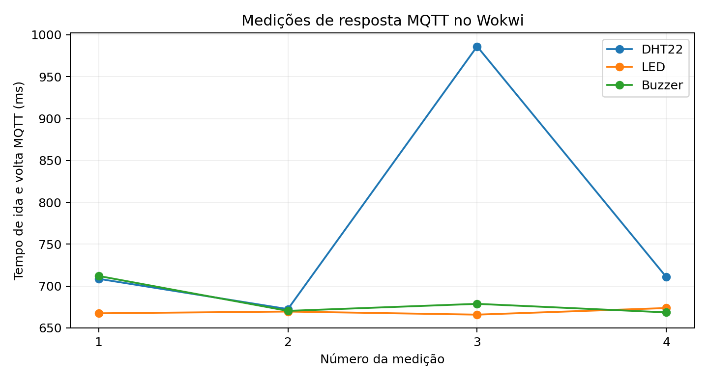
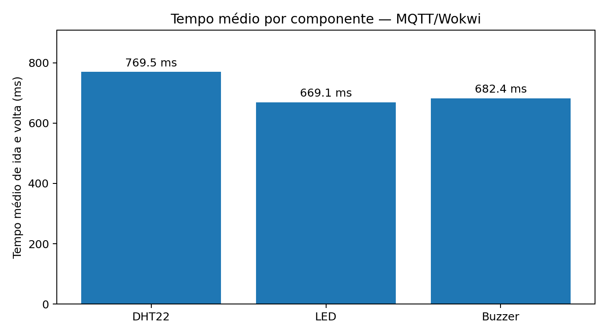

# Registro e interpretação das medições

## Procedimento
O painel HTML publica solicitações MQTT com um identificador, registra o instante do pedido no navegador e espera uma resposta do ESP32 via broker. O ESP32 responde com o ID e o tempo interno gasto na operação. O painel calcula o tempo entre publicação e recebimento da resposta (**RTT MQTT**, ida e volta). Foram solicitadas quatro medições por componente, com sensor DHT22, LED e buzzer.

Os dados originais contêm 16 registros: quatro primeiros testes incompletos/exploratórios (três do LED e um do buzzer), seguidos de 12 registros formando a série completa (4 de cada). Para as médias, usou-se a série completa; nada foi inventado nem apagado do original.

## Série completa
| Componente | Medida | RTT MQTT (ms) | Tempo interno ESP32 (ms) |
|---|---:|---:|---:|
| DHT22 | 1 | 708.60 | 5.519 |
| DHT22 | 2 | 672.40 | 0.023 |
| DHT22 | 3 | 986.20 | 0.023 |
| DHT22 | 4 | 710.70 | 5.096 |
| LED | 1 | 667.40 | 0.020 |
| LED | 2 | 669.50 | 0.020 |
| LED | 3 | 665.80 | 0.020 |
| LED | 4 | 673.70 | 0.020 |
| Buzzer | 1 | 712.00 | 0.764 |
| Buzzer | 2 | 670.30 | 0.904 |
| Buzzer | 3 | 678.70 | 0.764 |
| Buzzer | 4 | 668.50 | 0.764 |

## Médias

| Componente | Média RTT (ms) | Tempo interno médio (ms) |
|---|---:|---:|
| DHT22 | 769.475 | 2.665 |
| LED | 669.100 | 0.020 |
| Buzzer | 682.375 | 0.799 |

**Fórmula:** média = soma dos quatro tempos / 4.

## Limitações da metodologia

- RTT inclui comunicação via navegador/WebSocket, broker público e Wokwi. Não é latência em sentido único entre evento físico e recebimento MQTT.
- O tempo interno ESP32 reflete tempo de execução de trechos do firmware com `micros()`, não atraso elétrico, tempo de propagação na rede nem reação humana.
- Os valores são de **simulação**, não de circuito físico, e podem mudar entre execuções.
- A escolha da série completa após registros exploratórios deve ser declarada no artigo para transparência.
- Ao comparar com o enunciado, explicar essa limitação e, se possível, complementar com evidências cronometradas de eventos ponta a ponta.
