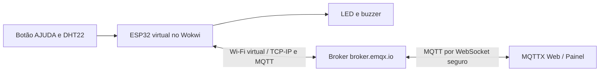

# Arquitetura, hardware e MQTT

## Arquitetura

O ESP32 reúne microcontrolador e rádio Wi-Fi. Ele publica as informações e se inscreve nos tópicos de comandos e de testes. O MQTTX Web e o painel HTML são outros clientes MQTT. O broker distribui mensagens entre os clientes conforme os tópicos assinados. Não há integração serial-USB, Firmata, shield ou Node-RED nesse circuito.

## Lista de tópicos MQTT

Prefixo: `mackenzie/oic/botao_b71f92`.

| Tópico (sufixo) | Direção | Conteúdo |
|---|---|---|
| `/temperatura` | ESP32 → broker | Temperatura ambiente em °C como texto, por exemplo `24.0` |
| `/umidade` | ESP32 → broker | Umidade relativa em % como texto, por exemplo `40.0` |
| `/emergencia` | ESP32 → broker | JSON: `{"evento":"AJUDA_SOLICITADA","origem":"BOTAO","uptime_ms":12345}` |
| `/status` | ESP32 → broker | Estado `ESP32_ONLINE`, `ALARME_ATIVO`, `ALARME_DESLIGADO` etc. |
| `/comando` | MQTTX → ESP32 | Texto `ALERTA` ou `PARAR` |
| `/medicao/pedido` | Painel → ESP32 | Texto `SENSOR|ID`, `LED|ID` ou `BUZZER|ID` |
| `/medicao/resposta` | ESP32 → painel | JSON com `tipo`, `id` e `tempo_local_ms`, ou mensagem de erro |

## Comportamento do firmware

1. Configura pinos, Wi-Fi e MQTT, inicializando o DHT22.
2. Inscreve-se nos tópicos de comando e medição.
3. A cada 5 segundos, lê o DHT22 e publica temperatura e umidade se houver conexão.
4. Ao pressionar o botão no Wokwi (GPIO18 em nível baixo), ativa LED e buzzer e publica pedido de ajuda.
5. Ao receber `ALERTA`, ativa os atuadores; ao receber `PARAR`, os desliga.
6. Desliga o alarme automaticamente após aproximadamente 4 segundos.
7. Ao receber uma solicitação de medição, executa a leitura ou aciona o componente, registra tempo local em microssegundos e publica a resposta com o ID do pedido.

## Tensão e alimentação

No modelo virtual, o DHT22 usa alimentação de 3,3 V. Há resistor de pull-up de 10 kΩ no barramento de dados do DHT22 e resistor de 220 Ω em série com o LED. O botão usa resistor interno de pull-up do ESP32. O buzzer do circuito é o modelo virtual do Wokwi; para uma montagem física, revisar sua corrente e a necessidade de driver antes de ligar ao GPIO.

## Testes e segurança

Este trabalho é **protótipo acadêmico virtual**: não deve ser utilizado como sistema de emergência real. Broker e Wi-Fi são destinados apenas à demonstração, com tópicos públicos não autenticados. A comunicação ESP32 → broker na porta 1883 não possui TLS na configuração atual.
